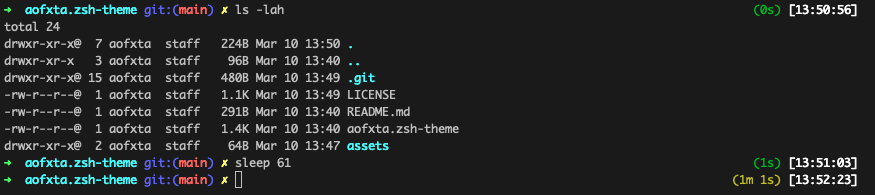

# aofxta.zsh-theme
I customize theme oh-my-zsh adds execution time

## Usage
Download:
```sh
wget -O ~/.oh-my-zsh/themes/aofxta.zsh-theme https://raw.githubusercontent.com/aofxta/aofxta.zsh-theme/main/aofxta.zsh-theme
```
Then edit `.zshrc` to use that theme.
```sh
nano ~/.zshrc
```
```sh
ZSH_THEME="aofxta"
```
Reload Zsh
```sh
source ~/.zshrc
```

Screenshot:
